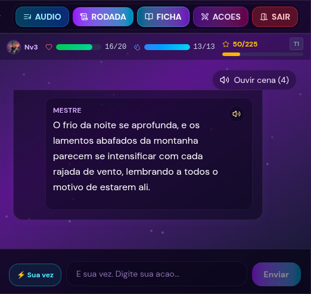
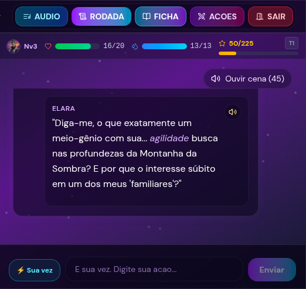
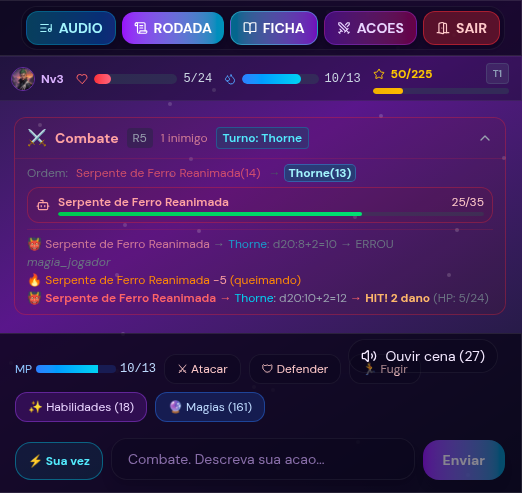
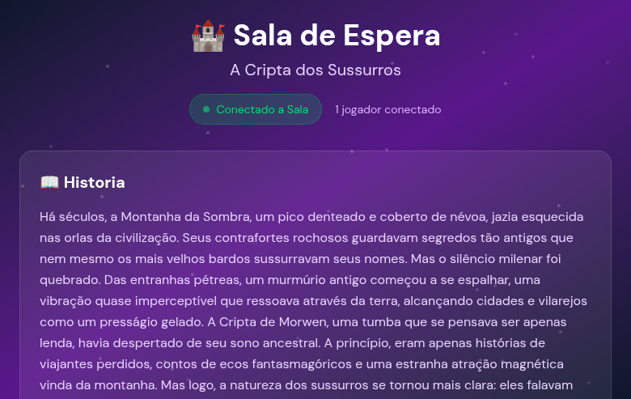
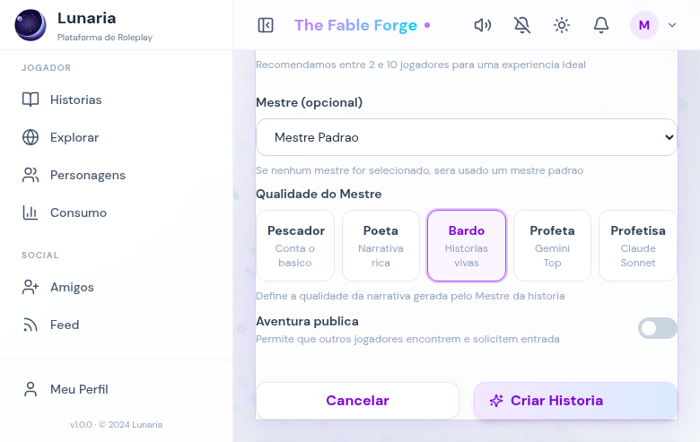
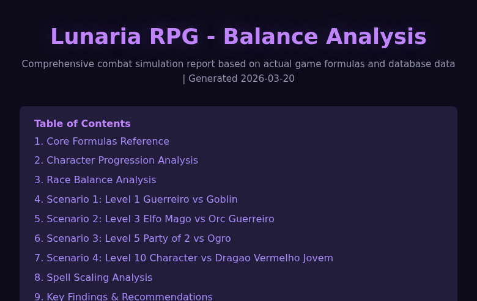

# Lunaria – The Fable Forge

> A real-time multiplayer tabletop RPG where an LLM Game Master narrates every move: streamed text and character voices, held to the rules by a deterministic engine.

<p align="center">
  <a href="docs/media/lunaria-trailer.mp4"></a>
</p>

<details name="trailer">
<summary><b>🔊 Watch with narration · English</b> (41 s)</summary>

https://github.com/user-attachments/assets/205b584e-d949-45a4-a0e9-74d7623084ab

</details>
<details name="trailer">
<summary><b>🔊 Assistir com narração · Português</b> (41 s)</summary>

https://github.com/user-attachments/assets/ec9244c5-3c06-40e7-b415-4f4877fbce29

</details>

<sub><b>How this video was made:</b> no screen recording and no video editor. One HTML page draws every frame from the real screenshots in <code>docs/screenshots/</code>; headless Chrome (Playwright) captures it at 30 fps, ffmpeg encodes it, and the soundtrack is synthesized in code, so there is no licensed music. The narration is Kokoro-82M text-to-speech, one of Lunaria's own voice providers, run locally (voice af_heart in English, pm_santa in Portuguese). Claude Code wrote the storyboard, the narration, the page and the render script; Marcelo reviewed and approved the cut.</sub>

Players build characters with a conversational wizard, create a story, invite friends into a room and play turn by turn. The Game Master is a team of LLM agents: one narrates, others review, summarize and plan the story arc. The server resolves the game mechanics **before** the model speaks, and the model changes game state only through a validated JSON action protocol. Narration streams token by token to every player in the room, and each NPC line can be played with its own voice.

The game is in Brazilian Portuguese, so code identifiers, prompts and commit messages are mostly in Portuguese. See the [glossary](#glossary).

Inspired by 3D&T and classic tabletop RPGs.

| Game Master narration | NPC dialogue with its own voice | Combat round |
|---|---|---|
|  |  |  |

## What it does

- **Character creation** through a conversational wizard (the *Creator* agent). Three rule systems: the native Lunaria system, a 3D&T-style system and a D&D 5e SRD-style system. The order of the wizard steps is decided by code, not by the model.
- **Story creation**: the AI writes the prologue and title on the spot; a 12-section story blueprint is generated in a background job (BullMQ).
- **Model quality per story**: five Game Master tiers, from a fast Gemini Flash-Lite up to Gemini 3.1 Pro or Claude Sonnet.
- **Turn-based play** in real time: free-text actions or combat buttons, d20 tests requested by the Game Master, initiative, HP/MP, status effects, loot, XP and level progression.
- **Voice**: narration comes back as segments (narration or NPC line, with emotion, pace and intensity); "Listen to scene" plays each segment with a voice per NPC.
- **Long sessions stay coherent** through automatic summarization, structured semantic memory and story-arc tracking.
- Procedural 3D maps of locations (three.js / React Three Fiber), AI-generated images of monsters and places, and a usage page with tokens and estimated cost per user.

| Waiting room (live connection, AI-written intro) | Story creation with the five Game Master tiers | Balance report from the game formulas |
|---|---|---|
|  |  |  |

## Architecture

```
            Browser: React 19 + TypeScript + Vite + Zustand + Tailwind + three.js/R3F
                 │ REST (axios, Zod contracts)              │ Socket.IO
                 ▼                                          ▼
 nginx ──► backend: Node 22 (ESM), Express 4 + Socket.IO
            ├─ routes → controllers → Prisma ──► PostgreSQL (50 models)
            ├─ websocket engines: session · turn · dice tests · combat · narration
            │     room state in Redis, snapshots in Postgres
            ├─ helpers: claim detector · game engine (3-layer intent) · action processor (21 actions)
            ├─ agents (LangChain): Game Master · Reviewer · Summarizer · Creator · Character · Story
            │     └─► Google Gemini · Groq · Anthropic Claude
            └─ BullMQ producer ──► Redis ──► worker: story blueprints · images · audio
 Voice:  ElevenLabs | Cartesia | Kokoro | self-hosted open-source TTS → SHA-256 audio cache
 Images: Gemini image model → object storage, with fallbacks
```

### The agents

| Agent / LLM role | What it does |
|---|---|
| **Game Master** (`backend/agents/Mestre`) | Narrates actions, opens sessions, asks for dice tests. Returns JSON: `narrativa`, `segmentos`, `acoes`, `metadados`, `combate`, `gancho`, `arcoStatus`. Streamed with LangChain `.stream()`. |
| **Creator** (`backend/agents/MestreCriador`) | Conversational character-creation wizard for the three rule systems, with catalog-based fallbacks when the model returns nothing useful. |
| **Character** (`backend/agents/Personagem`, `backend/agents/historia/personagem`) | Closes the initial build (combo and equipment), writes the background and validates the sheet. |
| **Reviewer** (`backend/agents/Revisores/unifiedReviewer.js`) | LLM-as-judge on every narration: mechanics, continuity and hook in one call. A failing narration with a correction replaces the original; errors fail open behind a circuit breaker (5 failures → 5 minutes off). |
| **Summarizer** (`backend/agents/Resumo`) | Incremental summary of the canonical history in blocks, merged with the previous summary. |
| **Story** (`backend/agents/historia`, `backend/services/blueprintService.js`) | Prologue, titles, and the 12-section blueprint, with a 3-provider fallback chain (Gemini 3.1 Pro → Claude Sonnet → Gemini 2.5 Pro) and a per-user hourly quota. A cheap model tracks arc progression from each summary. |
| **Intent classifier** (`backend/helpers/intentClassifier.js`) | Second layer of combat-intent routing: regex → Flash-Lite → Game Master, validated against the real character sheet. |
| Art direction and image prompts (`backend/services`) | Write the art direction and the prompt for the image model. |

**Counted in this repository:** 15 live modules call a chat model (Gemini, Groq or Claude, through LangChain; the blueprint fallback also uses the Anthropic SDK), plus one image model. The model catalog has 10 models and **5 Game Master tiers**. Retired models are migrated automatically on saved sessions (`DEPRECATED_MODELS`). Five legacy agent modules (the three reviewers replaced by the unified reviewer, and two archived agents) remain in the tree for reference.

### One turn, end to end

1. The client emits `mensagem_para_mestre` over Socket.IO with a `requestId`.
2. Under a per-room lock the server checks pending dice tests, defeat and turn order, registers the request and releases the lock. **The LLM call runs outside the lock.**
3. Guardrails before the model: prompt-input sanitization, a **claim detector** that checks what the player says they have (items, skills, mana, cooldowns) against the sheet and memory (a hard block skips the LLM, a soft one becomes a warning in the prompt), and combat mechanics resolved deterministically.
4. The Game Master streams its JSON; a small state machine extracts the `narrativa` field from the incomplete JSON so players see text as it arrives (`mestre_stream_start` / `_chunk` / `_end`).
5. The reviewer judges the narration and may replace it.
6. Under the lock again, the `acoes[]` of the response are applied by deterministic handlers, memory is merged, state is saved to Redis and broadcast.
7. Narration segments go to `POST /tts/generate`, cached by `SHA256(text|voice|provider)`.
8. Every 30 new canonical messages the summarizer runs and the story-arc progression is updated.

### JSON action protocol

There is no native tool calling. The Game Master emits `acoes[]` with **21 action types** (`dar_item`, `aplicar_dano`, `conjurar_magia`, `mudar_cenario`, `iniciar_fase_boss`, …), listed in `backend/agents/Mestre/prompts/sistema.js`. `backend/helpers/acoesProcessor.js` validates and applies each one. The model never writes game state directly. Its JSON is parsed defensively (direct parse, then fence and trailing-comma cleanup, then first `{…}` block, then XML-to-JSON), and protocol tags that leak into the prose are stripped.

### Real time

Socket.IO with 14 inbound events (`join_room`, `mensagem_para_mestre`, `dice_roll`, `regenerar_resposta_mestre`, `mensagem_roleplay`, …). Each request goes through `processing → streaming → reviewing` with a 3-second heartbeat, so a slow model never leaves the room guessing.

### Voice

Narration segments are typed (`narracao` or `fala_npc`) with emotion, pace and intensity. Providers: ElevenLabs, Cartesia, Kokoro, or the self-hosted, open-source [lunaria-open-tts](https://github.com/mazocelo/lunaria-open-tts) (FastAPI + Piper). Audio is cached by content hash.

### Evals

`backend/scripts/canonical-runner.js` replays **6 canonical scenarios** (`backend/tests/fixtures/scenarios/`) against real models and freezes the logs; `backend/tests/scenarios/invariants.js` checks **14 game invariants** on each log (JSON parseable, HP and mana within bounds, mana spent on spells, damage applied, monster defeated at 0 HP, XP distributed, no invented skills, no nonexistent spells accepted, targets referenced by id…). `npm run test:canonical` validates the frozen logs without spending tokens. Recorded run for scenario 01 (March 2026): Gemini Flash passed the 12 invariants that apply to it at 8.0 s mean latency, Claude Sonnet 12/12 at 17.1 s; the Groq run failed on a parse error.

## Engineering numbers

Counted on this repository (`git`, `grep`, `wc`):

| | |
|---|---|
| Commits | 1,333 non-merge commits, April 2025 to November 2026 (backend 568, frontend 758, root docs 7) |
| Test files | 109 (backend 55 Vitest, 4 of them scenario suites; frontend 49 Vitest + 5 Playwright e2e) |
| Test cases | 2,517 `it`/`test` blocks (backend 1,921, frontend 596) |
| LLM | 15 modules calling a chat model, 1 image model, 10 models in the catalog, 5 tiers |
| Game protocol | 21 action types, 14 inbound Socket.IO events |
| API and data | 217 REST route handlers (Swagger at `/api-docs`), 50 Prisma models |
| Code size | ~58k lines of backend JavaScript (runtime code), ~76k lines of frontend TypeScript/TSX (without tests) |

## How it was built

Lunaria was built by Marcelo working with AI coding agents (Claude Code) under his specs and review. The specs and implementation plans the agents followed are in `docs/superpowers/`, `backend/docs/superpowers/` and `frontend/docs/superpowers/`; the standing instructions for the agents are in the `CLAUDE.md` files; 1,054 of the 1,333 non-merge commits carry a `Co-Authored-By: Claude` trailer. The first 110 commits (April 2025 to February 2026) have none; Claude Code became the main implementer in March 2026.

## Running locally

Requirements: Node 22, PostgreSQL, Redis, and a Google AI (Gemini) API key. Groq and Anthropic keys are optional (other tiers and fallbacks).

```bash
# backend
cd backend
cp env.example .env          # DATABASE_URL, REDIS_URL, JWT secrets, GOOGLE_API_KEY
npm ci                       # also runs prisma generate
npx prisma migrate deploy
node seed-from-json.js       # loads the catalogs in docs/referencia-design/catalogos
npm run dev                  # API + Socket.IO on :3001
npm run worker               # BullMQ worker (story blueprints)

# frontend
cd ../frontend
echo "VITE_API_URL=http://localhost:3001" > .env.local
npm ci
npm run dev                  # Vite on :5173
```

Tests:

```bash
cd backend  && npm test && npm run test:canonical
cd frontend && npm test
cd frontend && E2E_EMAIL=... E2E_SENHA=... npm run test:e2e   # Playwright, needs a running stack and a test account
```

## Repository layout

```
backend/    Node.js API, Socket.IO engines, agents, Prisma schema, seeds, tests
frontend/   React 19 + TypeScript SPA, Vitest and Playwright suites
docs/       design references (attribute system, catalogs), specs and plans, analyses
```

This is a monorepo assembled from the original backend and frontend repositories; both keep their full commit history under their folders.

## Content and attribution

- Inspired by 3D&T and classic tabletop RPGs. Catalog names (monsters, items, races, deities) are original; mechanics and numbers are game rules.
- This work includes material taken from the System Reference Document 5.1 ("SRD 5.1") by Wizards of the Coast LLC and available at https://dnd.wizards.com/resources/systems-reference-document. The SRD 5.1 is licensed under the Creative Commons Attribution 4.0 International License available at https://creativecommons.org/licenses/by/4.0/legalcode.
- Lunaria is not affiliated with, endorsed or sponsored by Wizards of the Coast or Jambô Editora. Dungeons & Dragons and D&D are trademarks of Wizards of the Coast; 3D&T is a trademark of Jambô Editora.

## Glossary

| Portuguese | English |
|---|---|
| Mestre | Game Master |
| MestreCriador | character-creation wizard (Creator agent) |
| história / roteiro | story / story blueprint |
| sala | game room |
| ficha / personagem | character sheet / character |
| ações (`acoes`) | actions emitted by the Game Master |
| PV / PM | hit points / mana points |
| revisor | reviewer (LLM-as-judge) |

## Credits

Initial frontend scaffolding (April 2025) by adelson70.

## License

All rights reserved. This repository is published for portfolio review only; no license is granted to use, copy, modify or distribute it.
