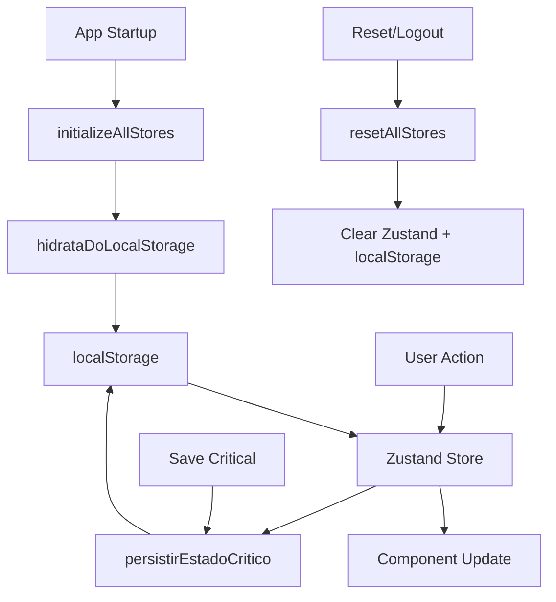

# 🏪 **Stores Architecture - Documentação**

## 📋 **Visão Geral**

Sistema de gerenciamento de estado global usando **Zustand** com arquitetura modular e separação clara de responsabilidades.

**🎯 PRINCÍPIO FUNDAMENTAL: Zustand é a fonte de verdade, localStorage é apenas para persistência/recuperação.**

## 🎯 **Separação de Responsabilidades**

### 🎮 **Game Store** (`src/store/game/`)
**Responsável por:** Estados e lógicas do JOGO em si

```javascript
// ✅ Estados do Game Store
etapaAtual           // Onde está no fluxo do jogo
historiaAtual        // História sendo jogada
personagensDaHistoria// Lista de personagens disponíveis
personagemSelecionado// Personagem escolhido pelo jogador
participantes        // Jogadores CONFIRMADOS na aventura (com personagens)
sessaoId            // ID da sessão de JOGO
mensagens           // Chat do RPG (in-game)
statusPersonagem    // HP, MP, etc.
```

### 🌐 **Socket Store** (`src/store/socket/`)
**Responsável por:** Estados e lógicas da CONEXÃO WebSocket

```javascript
// ✅ Estados do Socket Store
isConnected         // Status da conexão
isAuthenticated     // Se está autenticado
currentUser         // Dados do usuário logado
roomUsers          // TODOS conectados à room (técnico)
roomId             // ID técnico da room WebSocket
isTyping           // Se o usuário atual está digitando
latency            // Ping/latência da conexão
```

## 💾 **Nova Arquitetura de Persistência**

### **🎯 FONTE DE VERDADE: Zustand**
```javascript
// ✅ CORRETO - Zustand é sempre a fonte primária
const personagem = useGameStore(state => state.personagemSelecionado);
const historia = useGameStore(state => state.historiaAtual);

// ❌ ERRADO - Nunca consulte localStorage diretamente para estados ativos
const personagem = JSON.parse(localStorage.getItem('personagem')); // ❌
```

### **💾 PERSISTÊNCIA: Funções Específicas**
```javascript
// 🚀 INICIALIZAÇÃO (uma vez no app startup)
import { initializeAllStores } from '../store';
initializeAllStores(); // Recupera dados do localStorage → Zustand

// 💾 PERSISTÊNCIA EXPLÍCITA (quando necessário)
import { persistirEstadoCritico } from '../store';
persistirEstadoCritico(); // Zustand → localStorage

// 🧹 LIMPEZA (logout/reset)
import { resetAllStores } from '../store';
resetAllStores(); // Limpa Zustand + localStorage
```

### **🔄 FLUXO DE DADOS CORRETO**
```
1. 🚀 APP STARTUP:    localStorage → Zustand (hidratação)
2. 🎮 DURANTE USO:    User Actions → Zustand (fonte de verdade)
3. 💾 PERSISTÊNCIA:   Zustand → localStorage (quando necessário)
4. 🧹 CLEANUP:        Limpa ambos (Zustand + localStorage)
```

## ⚠️ **BOAS PRÁTICAS - useEffect**

### **🚫 EVITAR: Estados alterados dentro como dependências**
```javascript
// ❌ ERRADO - Causa loop infinito
const [loading, setLoading] = useState(false);

useEffect(() => {
  setLoading(true);
  fetchData().finally(() => setLoading(false));
}, [loading]); // ❌ 'loading' é alterado dentro
```

### **✅ CORRETO: Remover dependências que são alteradas**
```javascript
// ✅ CORRETO - Remove dependência problemática
const [loading, setLoading] = useState(false);

useEffect(() => {
  setLoading(true);
  fetchData().finally(() => setLoading(false));
}, []); // ✅ Array vazio - executa apenas na montagem

// Ou se precisar de id como dependência:
useEffect(() => {
  if (id && !data && !loading) {
    setLoading(true);
    fetchData(id).finally(() => setLoading(false));
  }
}, [id, data]); // ✅ Remove 'loading' das dependências
```

### **📋 REGRA GERAL:**
- **Se você altera um estado dentro do useEffect, NÃO coloque esse estado nas dependências**
- **Apenas inclua dependências que são "lidas" mas não "escritas" dentro do effect**

## 🚫 **O que NÃO é duplicação:**

| Game Store | Socket Store | Diferença |
|------------|-------------|-----------|
| `participantes` | `roomUsers` | Jogadores confirmados vs Todos conectados |
| `sessaoId` | `roomId` | ID do jogo vs ID técnico da room |
| `error` | `error` | Erros do jogo vs Erros de conexão |
| `mensagens` | - | Chat do RPG (não há duplicação) |
| - | `isTyping` | Status de digitação do usuário atual |

## 📁 **Estrutura dos Arquivos**

```
src/store/
├── index.js                    // 📦 Exports + utilities + init
├── README.md                   // 📖 Esta documentação
├── game/                       // 🎮 Game Store
│   ├── states.js              // 📊 Estados iniciais
│   ├── actions.js             // ⚡ Funções/lógicas + persistência
│   └── index.js               // 🔗 Combina states + actions + init
└── socket/                     // 🌐 Socket Store
    ├── states.js              // 📊 Estados iniciais
    ├── actions.js             // ⚡ Funções/lógicas
    └── index.js               // 🔗 Combina states + actions
```

## 🔧 **Como Usar**

### **🚀 INICIALIZAÇÃO (App.jsx):**
```javascript
import { initializeAllStores } from './store';

function App() {
  useEffect(() => {
    // Executar UMA vez na inicialização
    initializeAllStores();
  }, []);
  
  return <Router>...</Router>;
}
```

### **🎮 ESTADOS (Componentes):**
```javascript
// ✅ Uso direto do Zustand
const personagem = useGameStore(state => state.personagemSelecionado);
const { selecionarPersonagem } = useGameStore();

// ✅ Selectors computados
const { prontoParaJogar } = useGameSelectors.estadoProntidao();
```

### **💾 PERSISTÊNCIA (Quando Necessário):**
```javascript
import { persistirEstadoCritico } from '../store';

// Salvar antes de operações críticas
const handleSalvarProgresso = () => {
  persistirEstadoCritico(); // Salva estados críticos
};
```

### **🧹 LIMPEZA (Logout/Reset):**
```javascript
import { resetAllStores } from '../store';

const handleLogout = () => {
  resetAllStores(); // Limpa tudo
  navigate('/login');
};
```

## ⚡ **Funções de Persistência**

### **Game Store:**
- `hidrataDoLocalStorage()` - Recupera dados na inicialização
- `persistirEstadoCritico()` - Salva apenas dados críticos
- `limparDadosPersistidos()` - Remove dados do localStorage

### **Dados Persistidos:**
- ✅ **`personagemSelecionado`** - Escolha crítica do usuário
- ❌ **`historiaAtual`** - Pode ser recuperado via API
- ❌ **`etapaAtual`** - Pode ser derivado do contexto
- ❌ **Estados de socket** - São dinâmicos, não devem persistir

## 🔄 **Fluxo de Dados Visual**



## ✅ **Benefícios desta Arquitetura**

1. **🎯 Single Source of Truth:** Zustand é sempre a fonte primária
2. **💾 Persistência Controlada:** localStorage usado apenas quando necessário
3. **🔧 Manutenibilidade:** Funções específicas para cada operação
4. **🚀 Performance:** Não há consultas desnecessárias ao localStorage
5. **🛡️ Consistência:** Estados sempre sincronizados
6. **📚 Clareza:** Fluxo de dados bem definido e documentado
7. **⚠️ Sem Loops:** useEffects seguem boas práticas de dependências 